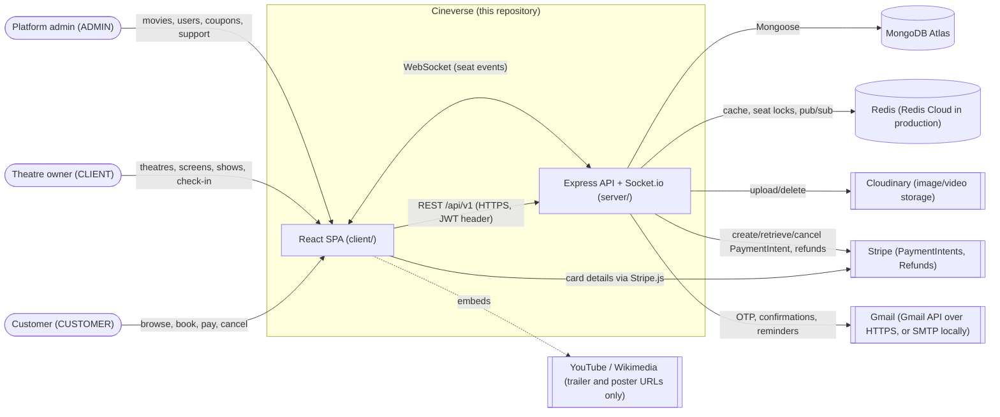
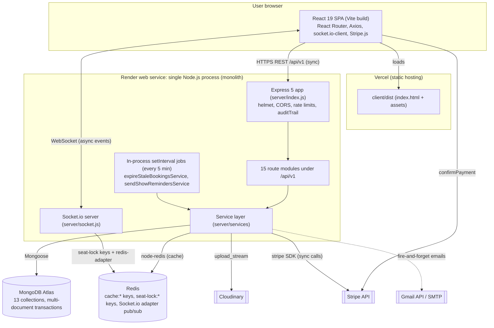
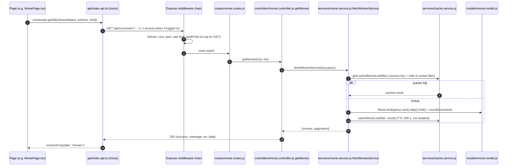
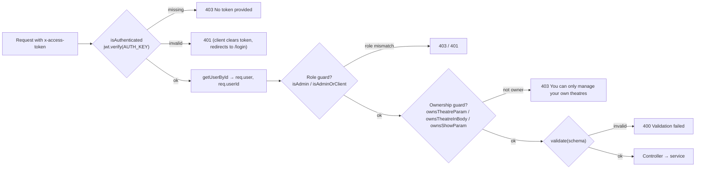
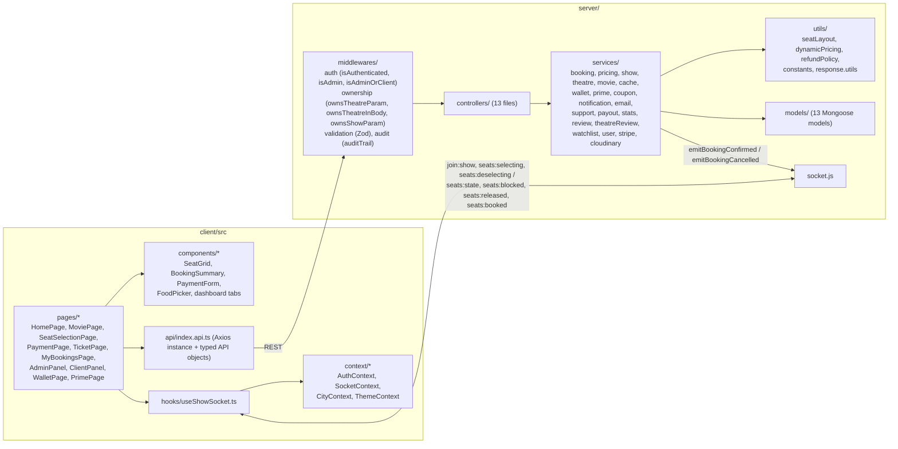

# 03 · Current system architecture

[← Back to index](README.md)

Everything on this page describes what **exists today**. Proposals are kept in [14 · Design gaps and recommendations](14-design-gaps-and-recommendations.md).

## 1. System context

*Source: [diagrams/system-context.mmd](diagrams/system-context.mmd)*

External systems with real integrations: **MongoDB Atlas**, **Redis**, **Stripe**, **Cloudinary** and **Gmail**. YouTube and Wikimedia only appear as URLs stored in movie documents; the server never calls them.

## 2. High-level architecture

*Source: [diagrams/current-architecture.mmd](diagrams/current-architecture.mmd)*

### Architectural style

- **Modular monolith.** A single Node.js process (`server/index.js`) contains the REST API, the Socket.io server and the scheduled jobs. Modules are folders (routes → controllers → services → models), not separately deployed services.
- **Single-page application.** `client/` builds into static files. All data comes from the API at run time. There is no server-side rendering.
- **Shared database.** All modules read and write the same MongoDB database. The data ownership notes below are logical conventions only, not enforced boundaries.
- **Redis has three jobs:** a read-through cache (`cache:*`), short-lived seat locks (`seat-lock:*`, `socket-seats:*`) and the Socket.io pub/sub adapter. `config/redis.js` opens **three connections**: publisher, subscriber, and a general client.

### Server start-up sequence (`server/index.js`)

1. `dotenv.config()`, then `await connectDB()`. The process stops if MongoDB is unreachable.
2. Register middleware in order: `helmet()` → `cors({ origin: CLIENT_URL })` → `express.json()` → general rate limiter → stricter auth rate limiter on `/auth/signin|signup|verify-otp|resend-otp|reset` → `auditTrail`.
3. Mount 15 routers under `/api/v1`, plus `GET /` and `GET /health`.
4. Create the HTTP server, `await connectRedis()` (the process stops if Redis is unreachable), then `initSocket(httpServer)`.
5. `listen(PORT)`, then start two `setInterval` timers (5 minutes each): `expireStaleBookingsService` and `sendShowRemindersService`.

**Not found in repository:** a global Express error-handling middleware, graceful shutdown handling, or readiness checks (`/health` returns `ok` without touching MongoDB or Redis).

## 3. Communication paths

| From → To | Protocol | Sync / async | Notes |
|---|---|---|---|
| Browser → API | HTTPS REST, JSON | Synchronous request/response | JWT in the `x-access-token` header (Axios interceptor). 15 s client timeout. |
| Browser ↔ Socket.io | WebSocket (polling fallback) | Asynchronous events | Rooms per show: `show:<showId>`. The client sends `auth.token`, but the **server never checks it**. |
| Browser → Stripe | Stripe.js | Synchronous in the browser | Card data goes to Stripe directly. |
| API → MongoDB | Mongoose driver | Synchronous (awaited) | Transactions for booking, cancel, gift card redemption. |
| API → Redis | node-redis | Synchronous (awaited) | Cache reads/writes; cache writes are fire-and-forget. |
| API → Stripe | Stripe SDK | Synchronous (awaited) | PaymentIntent create/retrieve/cancel, refunds. |
| API → Gmail / SMTP | HTTPS / SMTP | **Fire-and-forget** promises in the request process | Failures are logged, never retried. |
| API → Cloudinary | HTTPS upload stream | Synchronous | Upload endpoints only. |
| Timers → services | In-process function calls | Asynchronous (every 5 min) | Runs in every server process. |

## 4. Frontend-to-backend request flow

The same layering applies to every REST call. Example: a customer opens a movie list.

### Response envelope

Every hand-written controller returns `{ success, message, err, data }`. These are **module-level objects that are shared and mutated across requests** (`server/utils/response.utils.js`). Zod validation failures instead return `400 { success: false, err: <zod flatten>, message: "Validation failed" }` from `validation.middleware.js`. See [11](11-security-review.md#m1-shared-mutable-response-objects) for the risk this creates.

### Authentication on the request path

Note: `userStatus` (`PENDING`, `REJECTED`) is checked **only at signin** (and only for `REJECTED`), never on later requests.

## 5. Backend module interactions

*Source: [diagrams/component-architecture.mmd](diagrams/component-architecture.mmd)*

### Data ownership (logical)

| Module (services) | Collections it writes |
|---|---|
| `user.service`, `auth.controller` | `users` |
| `movie.service`, `review.service` | `movies` (incl. cached `rating`), `reviews` |
| `theatre.service`, `theatreReview.service` | `theatres` (incl. cached `rating`), `theatrereviews` |
| `show.service` | `shows` (except `bookedSeats`) |
| `booking.service` | `bookings`, `shows.bookedSeats`, coupon `usedCount` |
| `wallet.service`, `prime.service` | `wallettxns`, `giftcards`, `users.walletBalance`, `users.prime*` |
| `notification.service`, `support.service` | `notifications`, `supporttickets` |
| `audit.middleware` | `auditlogs` |

Cross-module writes happen inside `booking.service` (Show + Booking + Wallet in one transaction) and in `cancelBookingService` (Booking + Show + Wallet).

## 6. Real-time subsystem

`server/socket.js` exposes these events:

| Direction | Event | Payload | Effect |
|---|---|---|---|
| client → server | `join:show` | `showId` | Join room `show:<id>`; reply `seats:state` with locked seats (Redis `SCAN seat-lock:<id>:*`). |
| client → server | `leave:show` | `showId` | Leave room. |
| client → server | `seats:selecting` | `{showId, seats, userId}` | `SET seat-lock:<show>:<seat>` with `EX 600`; track in `socket-seats:<socketId>`; broadcast `seats:blocked`; `setTimeout` 600 s to broadcast `seats:released`. |
| client → server | `seats:deselecting` | `{showId, seats, userId}` | Delete locks whose stored `userId` equals the payload's `userId`; broadcast `seats:released`. |
| (disconnect) | — | — | Release every lock recorded for that socket. |
| server → room | `seats:booked` | `{showId, seats}` | Sent by `emitBookingConfirmed` after payment; also deletes the lock keys. |
| server → room | `seats:released` | `{showId, seats}` | Sent on deselect, disconnect, timeout, or booking cancellation. |

The Redis adapter (`@socket.io/redis-adapter`) means room broadcasts would reach sockets on other server instances. Production runs a single instance today.
