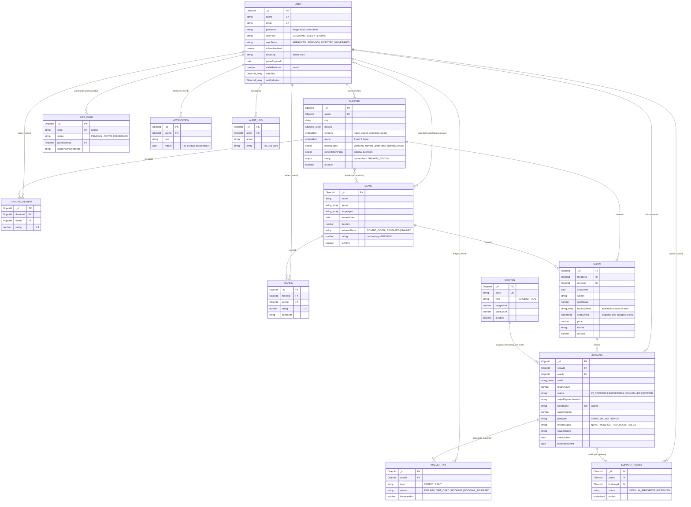

# 06 · Database design

[← Back to index](README.md)

**Engine:** MongoDB (Atlas in production; an in-memory single-node replica set in tests). **ODM:** Mongoose 9. **Schema source of truth:** `server/models/*.js`. **Migrations:** none exist. Schema changes rely on Mongoose defaults; for example, a show with `seatLayout: null` is treated as a "legacy 8×10 single-price" show.

Transactions require a replica set. Atlas provides one, and `tests/setup/testDb.js` creates one for the same reason.

## ER diagram

*Source: [diagrams/database-erd.mmd](diagrams/database-erd.mmd)*

Relationships are application-level `ObjectId` references (`ref:`). MongoDB enforces none of them, so deletes can leave dangling references (see [Consistency](#consistency-and-discrepancies)).

## Collections

### `users` — `user.model.js`

| Field | Type / constraint | Notes |
|---|---|---|
| `name` | String, **unique**, required | Uniqueness on display name is unusual. A second "Rahul Sharma" cannot register (duplicate-key error). |
| `email` | String, **unique**, lowercase, regex | |
| `password` | String, `select: false`, bcrypt (cost 10) in `pre("save")` | |
| `isEmailVerified`, `emailOtp`, `emailOtpExpiry` | OTP fields `select: false` | |
| `userRole` | `CUSTOMER` \| `ADMIN` \| `CLIENT` | |
| `userStatus` | `APPROVED` \| `PENDING` \| `REJECTED` \| `UNVERIFIED` | `UNVERIFIED` is in the enum but never assigned. |
| `primeExpiresAt`, `primeSince`, `primeTrialUsed`, `primePaymentIds[]` (`select:false`) | | `primePaymentIds` makes `/prime/confirm` idempotent |
| `walletBalance` | Number, `min: 0` | Running total; ledger in `wallettxns` |
| `watchlist[]`, `notifyMovies[]` | ObjectId → Movie | Multikey indexes on both |

### `movies` — `movie.model.js`

Fields: `name` (indexed), `description` (≤2000), `casts[]`, `trailerUrl` (http regex), `languages[]`, `releaseDate` (indexed), `duration`, `posterUrl`, `bannerUrl`, `images[]`, `genre[]` (indexed), `rating` (0–10, cached), `certificate` (`U|UA|A|R|PG-13`), `director`, `releaseStatus` (`COMING_SOON|RELEASED|BANNED`), `isActive`.
Indexes: text (`name`, `description`), `{releaseStatus, isActive}`, `{genre, releaseDate:-1}`.

### `theatres` — `theatre.model.js`

| Field | Notes |
|---|---|
| `owner` | ObjectId → User (indexed) |
| `name`, `city` (indexed), `state`, `pincode`, `address`, `location{lat,lng}` | |
| `movies[]` | ObjectIds of movies this theatre may schedule. It duplicates what `shows` imply. |
| `screens[]` | Embedded: `name`, `sound`, `projection`, `photo`, `layout{rows[], cols ≤40, aisles[], categories[{key,label,price,rows[]}], accessible[]}` |
| `menu[]` | Embedded F&B items with `_id`, `price`, `veg`, `available` |
| `pricingRules` | `weekendPct, morningPct, primeTimePct, openingDayPct` (−50…+100) |
| `cancellationPolicy` | Optional overrides of the platform refund windows |
| `rating{avg,count,cleanliness,sound,seating}` | Cached from `theatrereviews` |
| `amenities[]`, `images[]`, `amenityPhotos`, `phone`, `openingHours`, `totalScreens`, `isActive` | |

Indexes: `{city, isActive}`, text (`name`, `description`), `owner`, `name`.

### `shows` — `show.model.js`

| Field | Notes |
|---|---|
| `theatreId`, `movieId`, `showTime`, `screen` | |
| `noOfSeats`, `price` | Derived from the layout snapshot when one exists (`price` = cheapest category) |
| **`bookedSeats[]`** | **The availability source of truth.** A seat is unavailable if its id (e.g. `"H12"`) is in this array. It holds seats of both `IN_PROCESS` and `SUCCESSFUL` bookings. |
| `seatLayout` | Snapshot of the screen layout with category prices after dynamic pricing. Later screen edits don't reprice existing shows. |
| `priceAdjustments[]` | `[{label:"Weekend", pct:20}]` applied at scheduling |
| `language`, `format` (`2D|3D|IMAX|4DX|Dolby Atmos`), `tags[]`, `isActive` (indexed) | |

Indexes: `{theatreId, movieId, showTime}`, `isActive`. **No unique constraint** on `(theatreId, screen, showTime)`.

### `bookings` — `bookings.model.js`

| Field | Notes |
|---|---|
| `showId`, `userId` | Both indexed |
| `seats[]` | ≥1 (validator); ≤10 enforced by Zod |
| `totalAmount`, `subtotal`, `discount`, `lineItems[]`, `addOns[]`, `addOnsTotal`, `couponCode` (indexed), `couponDiscount`, `bookingFee`, `bookingFeeGst`, `feeWaived`, `primeApplied` | Price snapshot at purchase time |
| `walletApplied`, `paidWith` (`CARD|WALLET|MIXED`) | |
| `status` | `IN_PROCESS` (default) \| `SUCCESSFUL` \| `CANCELLED` \| `EXPIRED` |
| `stripePaymentIntentId` (indexed), `stripeClientSecret` | The client secret is stored in the database. |
| `ticketCode` | **Unique, sparse**; `CV-` + 12 hex chars; set on confirmation |
| `cancelledAt`, `cancellationReason`, `refundAmount`, `refundStatus` (`NONE|PENDING|REFUNDED|FAILED`), `refundMethod` (`SOURCE|WALLET|null`), `stripeRefundId` | |
| `checkedInAt`, `reminderSentAt` | Set by conditional updates (exactly once) |

Indexes: `{userId, createdAt:-1}`, `{showId, status}`, `{stripePaymentIntentId}`, plus single-field `showId`, `userId`, `couponCode`.

### Other collections

| Collection | Key fields | Constraints / indexes |
|---|---|---|
| `reviews` | `movieId`, `userId`, `rating 1–10`, `comment 10–1000`, `likes[]` | **Unique `{movieId, userId}`** |
| `theatrereviews` | `theatreId`, `userId`, `rating/cleanliness/sound/seating 1–5`, `comment` | **Unique `{theatreId, userId}`**, `{theatreId, createdAt:-1}` |
| `coupons` | `code` (upper-case, 3–20 alnum), `type PERCENT|FLAT`, `value`, `maxDiscount`, `minAmount`, `validFrom/Until`, `usageLimit`, `perUserLimit`, `usedCount`, `isActive` | **Unique `code`**; PERCENT ≤ 100 validator |
| `wallettxns` | `userId`, `type CREDIT|DEBIT`, `amount`, `reason`, `bookingId?`, `balanceAfter` | `{userId, createdAt:-1}`; append-only by convention |
| `giftcards` | `code` (set when paid), `amount`, `status PENDING|ACTIVE|REDEEMED`, `purchasedBy`, recipient fields, `stripePaymentIntentId`, `redeemedBy/At`, `expiresAt` | **Unique sparse `code`**, `stripePaymentIntentId`, `{purchasedBy, createdAt:-1}` |
| `notifications` | `userId`, `type`, `title`, `body`, `link`, `image`, `readAt` | `{userId, createdAt:-1}`; **TTL 60 days** |
| `supporttickets` | `userId`, `bookingId?`, `category`, `subject`, `message`, `status OPEN|IN_PROGRESS|RESOLVED`, embedded `replies[]` | `userId`, `status`, `{status, updatedAt:-1}` |
| `auditlogs` | `actor`, `actorName`, `role`, `action`, `entity`, `entityId`, `summary`, `fields[]`, `ip` | `{createdAt:-1}`, `{entity, createdAt:-1}`, `{actor, createdAt:-1}`; **TTL 365 days** |

## How seat availability is represented

- **Persistent:** `Show.bookedSeats` (array of seat ids on the show document) + `Show.seatLayout` (which seat ids exist and their category).
- **Ephemeral:** Redis keys `seat-lock:<showId>:<seat>` with a 600 s TTL. These are only used to grey out seats in other browsers; the booking service never reads them.
- **Derived:** available = seats in layout − `bookedSeats`. Seat ids are validated against the layout in `priceSeats` (`/^([A-Z])(\d{1,2})$/`, row in layout, column ≤ `cols`).

There is no per-seat document and no unique index per seat. Correctness depends on every writer to `bookedSeats` using the conditional update pattern. `PATCH /shows/:id` does not follow it (see below).

## Transaction boundaries

| Operation | Inside one MongoDB transaction | Outside (after commit) |
|---|---|---|
| `initiateBookingService` | Read show → conditional `$push` to `bookedSeats` → wallet debit + ledger → **Stripe PaymentIntent create** → `Booking.create` | `afterConfirmed` for wallet-only bookings |
| `confirmBookingService` | `Booking` IN_PROCESS → SUCCESSFUL + `ticketCode` | Stripe retrieve happens **before**; coupon `usedCount++`, socket broadcast, notification, email **after** |
| `cancelBookingService` | Booking → CANCELLED (guarded on the quoted status) → `$pull bookedSeats` → wallet credit + ledger | Stripe PaymentIntent cancel or refund, `booking.save()` of refund fields, socket, notification, email |
| `redeemGiftCardService` | Gift card ACTIVE → REDEEMED + wallet credit | — |
| Check-in, Prime trial/confirm, gift card confirm, reminders | Single-document conditional updates (atomic without a transaction) | — |

**Plausible risk:** `session.withTransaction()` may re-run its callback on transient errors. Because `paymentIntents.create` runs inside the callback, a retry would create a second, unused PaymentIntent. That is harmless for money (it's never confirmed) but leaves orphans in Stripe.

## Query patterns vs indexes

| Query (code) | Supporting index | Assessment |
|---|---|---|
| `GET /movies` filters on `releaseStatus, isActive`, sort `releaseDate` | `{releaseStatus, isActive}` | OK; cached in Redis anyway |
| `GET /shows?upcoming=true` → `{isActive:true, showTime ≥ now}`, sort `showTime` | `isActive` only (compound index starts with `theatreId`) | **Plausible risk:** scans every active show at larger volumes |
| `GET /shows?movieId=…` | none starting with `movieId` | Same as above |
| Expiry job `{status:"IN_PROCESS", createdAt < cutoff}` | none on `status` | Scans bookings every 5 min (fine at current size) |
| Reminder job `Show.find({showTime in window, isActive})` then `Booking.find({showId ∈ …, status, reminderSentAt:null})` | `{showId, status}` | Second query OK; first scans shows |
| `GET /bookings/my` `{userId}` sort `createdAt` | `{userId, createdAt:-1}` | OK |
| Coupon per-user usage `countDocuments({userId, couponCode, status ∈ …})` | `couponCode` | OK at current scale |

Measured data size at the time of writing (seed data): 23 movies, 15 theatres, 3,858 shows, ~15.7 k bookings.

## Consistency and discrepancies

| # | Finding | Type |
|---|---|---|
| D1 | `PATCH /shows/:id` passes `updateShowSchema.parse()` output to `findByIdAndUpdate`. Zod defaults add `bookedSeats: []` and `isActive: true`, so a dashboard edit **erases sold seats** (reproduced). | Verified limitation (critical) |
| D2 | `BOOKING_STATUS.expired` exists, but the expiry job sets `CANCELLED`, so `EXPIRED` is never stored. | Verified |
| D3 | Hard deletes (`DELETE /movies/:id`, `/theatres/:id`, `/shows/:id`, `/users/:id`) leave bookings, shows and reviews pointing at missing documents. `refundQuote` treats a missing show as "full refund". | Verified |
| D4 | Denormalised caches: `Movie.rating`, `Theatre.rating`, `Coupon.usedCount`, `User.walletBalance`. They are updated by the service that writes the source rows. `usedCount` is incremented after the confirm transaction, so a crash in between under-counts it. | Verified (design choice) |
| D5 | Coupon `usageLimit` is checked at quote/initiate time against `usedCount`, which is only incremented on confirm. Concurrent checkouts can exceed the limit. | Verified limitation |
| D6 | `Theatre.movies[]` and `shows` can disagree. Removing a movie from a theatre doesn't remove its shows. | Plausible |
| D7 | `User.name` is unique, which blocks legitimate duplicate names. | Verified |
| D8 | `stripeClientSecret` is persisted, although it is only needed by the browser at checkout. | Verified (low risk) |
| D9 | `theatreUpdateSchema` and `movieUpdateSchema` inject defaults (`totalScreens:1, amenities:[], images:[]`; `certificate:"UA", releaseStatus:"COMING_SOON"`) on partial updates. The dashboard forms send full objects, so the UI is unaffected, but direct API callers aren't. | Verified (latent) |
