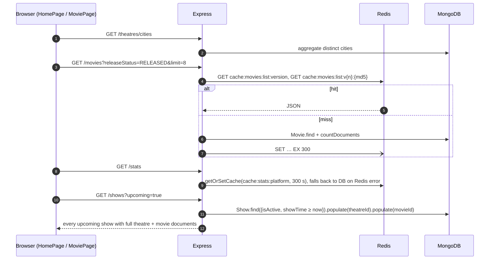
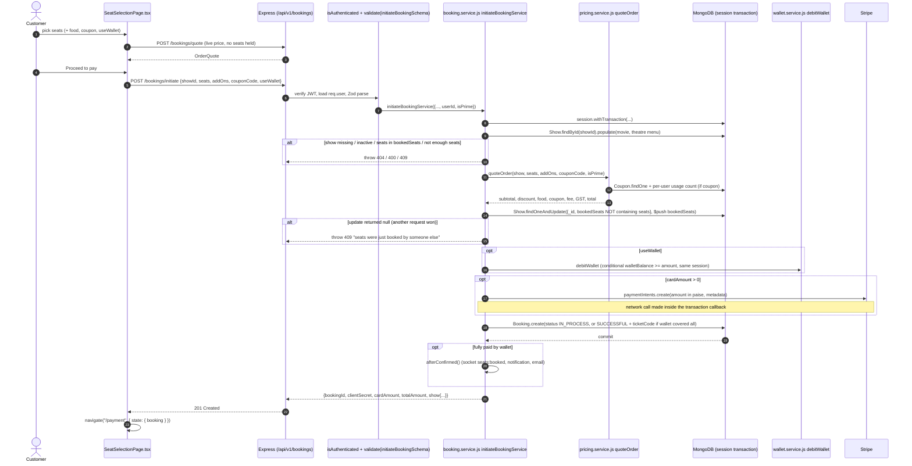
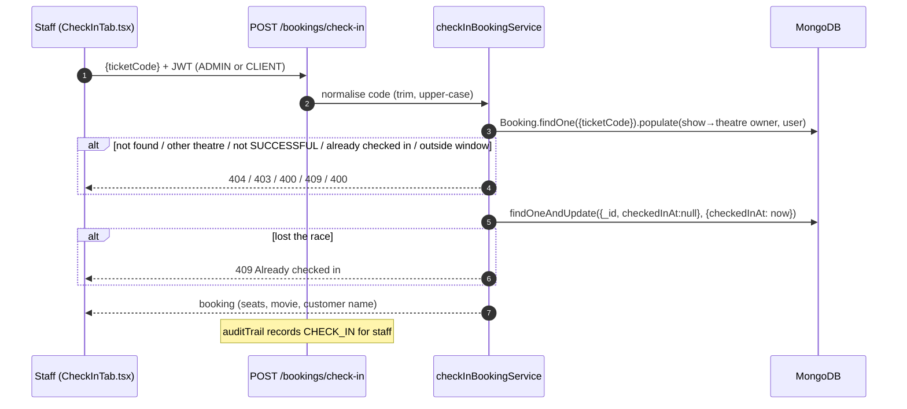
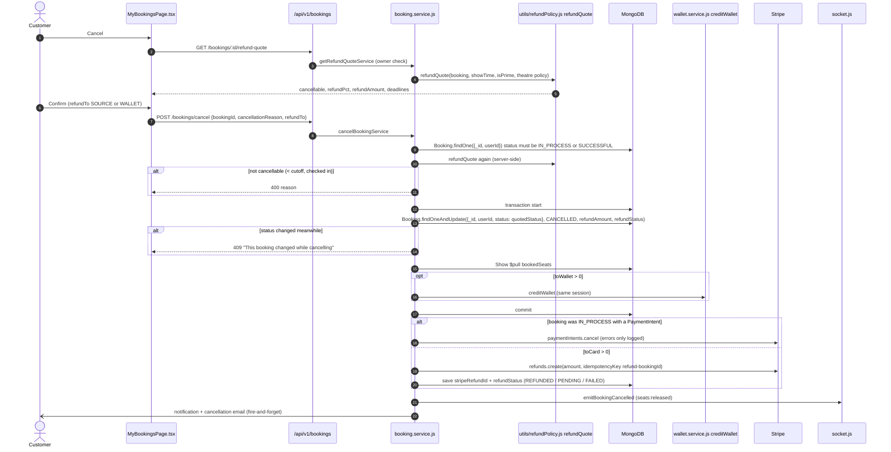
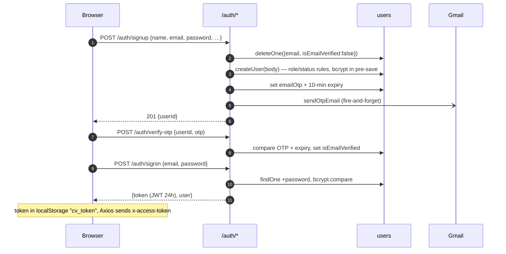
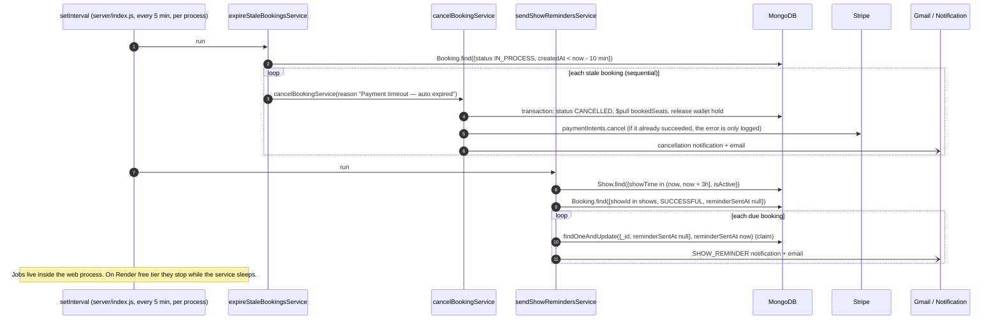

# 07 · Major workflows

[← Back to index](README.md)

Each workflow follows the same outline: purpose, entry points, steps, diagram, database changes, errors, limitations and (separately labelled) improvements. Booking concurrency and payments have their own deep-dives in [08](08-booking-and-concurrency-analysis.md) and [09](09-payment-and-failure-handling.md).

---

## A. Event discovery (movies, theatres, showtimes)

**Purpose:** let visitors find what's playing and where.

**Entry points:** `client/src/pages/HomePage/HomePage.tsx`, `pages/movies/*`, `context/CityContext.tsx` → `GET /movies`, `/movies/:id`, `/movies/:id/similar`, `/theatres`, `/theatres/cities`, `/shows`, `/reviews/top`, `/stats`.

**Steps**
1. On load, `CityProvider` calls `GET /theatres/cities`. On a first visit with more than one city, it opens the city picker. The chosen city is stored in `localStorage`.
2. The home page loads released and coming-soon movies (`GET /movies?releaseStatus=…&limit=8`), top reviews, theatres in the city and `GET /stats`.
3. `ShowtimePicker` and `MoviePage` call `GET /shows?upcoming=true` (all upcoming shows, unfiltered by city on the server).
4. The movie detail page loads the movie, similar movies, reviews and shows for that movie.

**Database changes:** none (read-only); cache writes in Redis.

**Errors:** movie list → 500 "Failed to fetch movies" on any DB **or Redis** error. Stats fall back to MongoDB if Redis fails.

**Verified limitations**
- `GET /shows?upcoming=true` has no pagination, projection or city filter. Measured on production: 0.63 MB gzip, about 12 s (17 Oct 2026, ~1,100 upcoming shows).
- The movie list cache has no fallback, so a Redis outage takes discovery down.

**Proposed improvements:** paginate and project `/shows`, filter by city and date on the server, add a `{isActive, showTime}` index, and wrap cache reads in try/catch that falls back to MongoDB (as `stats.service.js` already does).

---

## B. Seat availability

**Purpose:** show which seats can be bought, and update that live.

**Entry points:** `SeatSelectionPage.tsx` → `GET /shows/:id`; `hooks/useShowSocket.ts` ↔ `server/socket.js`.

**Steps**
1. `GET /shows/:id` returns the show with `seatLayout` and `bookedSeats`. Seats in `bookedSeats` render as sold.
2. The socket emits `join:show`. The server replies `seats:state` with every `seat-lock:<show>:*` key in Redis (`SCAN`), and those seats render as "being selected".
3. Events `seats:blocked`, `seats:released` and `seats:booked` keep both sets current.

**Database changes:** none. Redis keys only.

**Verified limitations:** the socket isn't authenticated and trusts the client's `userId` (see [08](08-booking-and-concurrency-analysis.md#4-seat-lock-layer-redis--socketio)). `setTimeout`-based release broadcasts are lost if the process restarts, though the Redis keys still expire.

---

## C. Booking creation

Covered step by step in [08 · Booking and concurrency analysis](08-booking-and-concurrency-analysis.md).

*Source: [diagrams/booking-sequence.mmd](diagrams/booking-sequence.mmd)*

---

## D. Payment

Covered in [09 · Payment and failure handling](09-payment-and-failure-handling.md).

---

## E. Ticket generation, retrieval and validation

**Purpose:** give the customer a scannable ticket and let staff admit them once.

**Entry points:** `confirmBookingService` (generation) → `TicketPage.tsx` / `TicketCard.tsx` (display) → `CheckInTab.tsx` → `POST /bookings/check-in` (validation).

**Steps**
1. On confirmation, the server sets `ticketCode = "CV-" + 12 upper-case hex chars` (6 random bytes from `crypto.randomBytes`). The unique sparse index prevents duplicates.
2. `TicketCard.tsx` draws a QR code of the **plain ticket code** with the `qrcode` library. "PDF / Print" uses `window.print()`.
3. `GET /bookings/:id` (owner of the booking only) reloads the ticket later. `GET /bookings/my` lists all of the user's bookings.
4. At the entrance, `CheckInTab.tsx` reads the QR with the browser `BarcodeDetector` + camera (Chromium) or takes a typed code, and calls `POST /bookings/check-in`.
5. `checkInBookingService` checks that the caller is the admin or the theatre's owner, that the status is `SUCCESSFUL`, and that it is within 3 h before to 4 h after showtime. It then runs `findOneAndUpdate({_id, checkedInAt: null}, {checkedInAt: now})` so two scanners can't admit the same ticket.

**Database changes:** `bookings.checkedInAt`, `auditlogs` insert.

**Limitations:** the QR holds an unsigned code (48 bits of randomness). That is unguessable in practice, but a screenshot of someone else's QR works until first use. A checked-in booking cannot be cancelled (`refundQuote` blocks it).

**Proposed improvement:** sign the QR payload (HMAC of booking id + code) so it can be checked offline. This is optional at this scale.

---

## F. Cancellation and refunds

*Source: [diagrams/cancellation-sequence.mmd](diagrams/cancellation-sequence.mmd)*

**Entry points:** `MyBookingsPage.tsx`, `BookingCard.tsx` → `GET /bookings/:id/refund-quote` → `POST /bookings/cancel` → `cancelBookingService`, `utils/refundPolicy.js`.

**Rules (`refundQuote`, platform defaults in `CANCELLATION_POLICY`, per-theatre overrides allowed):**

| Situation | Result |
|---|---|
| Booking `IN_PROCESS` (unpaid) | Always cancellable, refund 0, wallet hold released |
| Already checked in | Not cancellable |
| Show document missing (hard-deleted) | Cancellable, **100 % of `totalAmount`** including fees |
| ≥ 24 h before show | 100 % of (total − booking fee − GST) |
| 2–24 h before show | 50 % (Prime: 100 %) of (total − fee − GST) |
| < 2 h before show | Not cancellable |

**Database changes (transaction):** booking → `CANCELLED` with refund fields; `$pull` seats from `bookedSeats`; wallet credit + ledger row if any part goes to the wallet. **After commit:** Stripe `refunds.create` (idempotency key `refund-<bookingId>`) or `paymentIntents.cancel`; refund status saved.

**Errors:** 400 (not cancellable / not found), 409 (status changed between quote and update). A Stripe refund error after commit sets `refundStatus: FAILED`, but the booking stays cancelled and the seats released.

**Verified limitations:** a `PENDING` or `FAILED` refund is never retried or reconciled. A show that the theatre deactivates or deletes doesn't trigger refunds or notifications. Customers must cancel themselves.

---

## G. Authentication and authorisation

**Entry points:** `SignUpPage.tsx`, `OtpVerificationPage.tsx`, `LoginPage.tsx`, `AuthContext.tsx` → `/auth/*` → `auth.controller.js`, `user.service.js`, `auth.middleware.js`.

**How identity affects operations:** see the guard table in [05](05-api-inventory.md#conventions) and [11](11-security-review.md).

**Verified limitations:** mass assignment on signup; `PENDING` not enforced; OTP compared with `!==` and has no attempt counter (the rate limiter is the only brute-force control: 20 requests per 15 min per IP); an expired JWT returns 500; no logout or revocation on the server (JWTs are stateless).

---

## H. Notifications and emails

| Trigger | In-app (`notifications`) | Email | Where |
|---|---|---|---|
| Booking confirmed | ✓ `BOOKING_CONFIRMED` | ✓ | `afterConfirmed` |
| Booking cancelled (user or expiry job) | ✓ `BOOKING_CANCELLED` | ✓ | `cancelBookingService` |
| First upcoming show for a movie scheduled | ✓ `BOOKINGS_OPEN` to watchlist / notify-me users (notify-me is then cleared) | — | `notifyBookingsOpen` |
| Show within 3 h | ✓ `SHOW_REMINDER` | ✓ | `sendShowRemindersService` |
| Admin replies to support | ✓ `SUPPORT_REPLY` | — | `replyTicketService` |
| New movie created | — | ✓ to **every APPROVED user**, from the request process | `createMovieService` |
| Gift card purchased with recipient | — | ✓ | `confirmGiftCardService` |

Transport: Gmail REST API (`users/me/messages/send`, OAuth2 refresh token) when `GMAIL_REFRESH_TOKEN` is set; otherwise Nodemailer + Gmail SMTP. All sends are fire-and-forget: failures are logged, never retried or queued.

**Verified limitation:** the "new movie" fan-out sends one email per approved user from the API process. Gmail's sending limits (~500/day for a consumer account) make this unsafe beyond a few hundred users.

---

## I. Background jobs

*Source: [diagrams/background-jobs.mmd](diagrams/background-jobs.mmd)*

| Job | Schedule | Idempotency | Failure behaviour |
|---|---|---|---|
| `expireStaleBookingsService` | `setInterval` 5 min in every process | Each cancel is guarded on status (`findOneAndUpdate({status: before.status})`) | Errors per booking are logged; the loop continues. |
| `sendShowRemindersService` | `setInterval` 5 min in every process | Claim via `reminderSentAt: null` conditional update | Email failure is logged; the booking stays marked as reminded (no retry). |

**Verified limitations:** jobs don't run while the Render free instance sleeps. A booking can stay `IN_PROCESS` (seats held) for 10–15 minutes, longer if the process slept. There's no job history or alerting.

---

## J. Owner scheduling (supporting workflow)

1. The owner creates a theatre with screens (layouts validated by `assertValidLayout`) and pricing rules.
2. They attach movies (`PATCH /theatres/:id/movies`).
3. They schedule shows: single (`POST /shows`, **no overlap check**) or bulk (`POST /shows/bulk`, skips overlaps using movie duration + 20 min turnaround, ≤120 times).
4. Each show snapshots the screen layout with dynamic pricing (`priceAdjustmentsFor` in IST).
5. If this is the first upcoming show of the movie, `notifyBookingsOpen` notifies interested users.

**Verified limitation:** editing a show afterwards wipes `bookedSeats` ([C2](11-security-review.md#c2-show-edit-wipes-sold-seats)).
