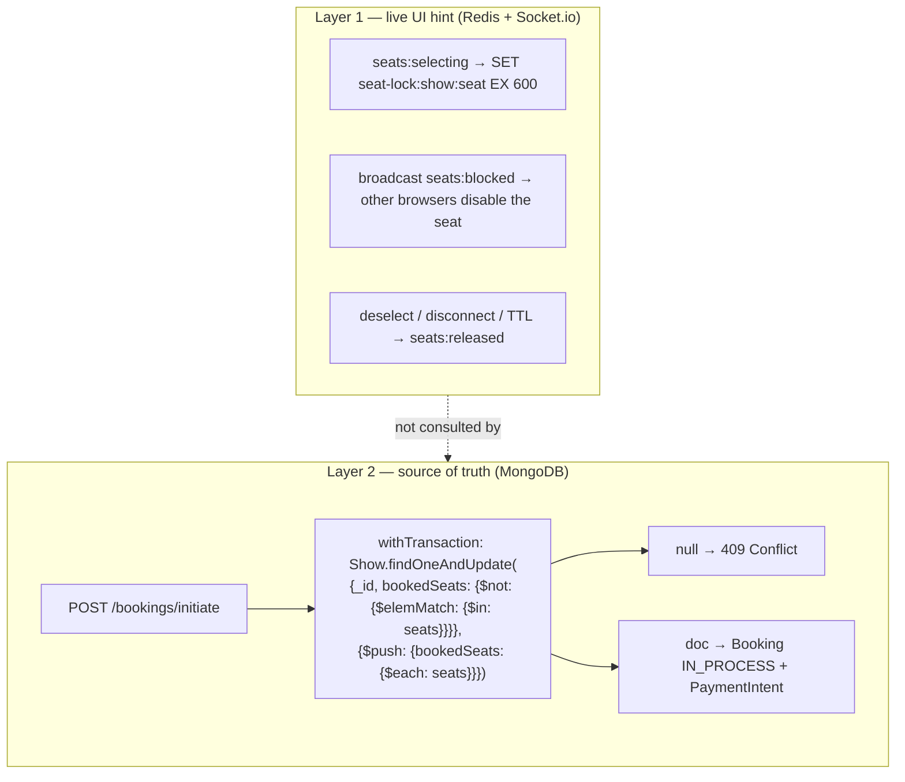
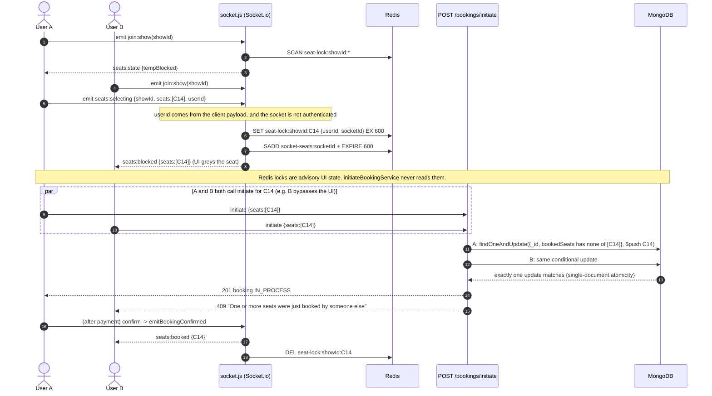

# 08 · Booking and concurrency analysis

[← Back to index](README.md)

## 1. Summary

| Question | Answer (current implementation) |
|---|---|
| What stops two people buying the same seat? | A MongoDB transaction in `initiateBookingService` that adds seats to `Show.bookedSeats` with a **conditional `findOneAndUpdate`**: the filter matches only if none of the requested seats is already in the array. |
| What do the Redis seat locks do? | They drive the live seat map (grey "being selected" seats). **The booking service never reads them.** They are advisory UI state. |
| Is booking creation idempotent? | Not by key. A duplicate request for the same seats fails with **409** because the first request already reserved them. A duplicate for different seats creates a second booking. |
| When are seats reserved? | At `POST /bookings/initiate`, before payment. They stay reserved while the booking is `IN_PROCESS` (up to ~10–15 min) and become permanent when it turns `SUCCESSFUL`. |
| Is there a guarantee break? | **Yes, verified:** editing a show through `PATCH /shows/:id` resets `bookedSeats` to `[]` ([§5](#5-verified-break-show-edits-wipe-bookedseats)). |

## 2. The two layers

## 3. Booking creation, step by step

Source: `server/services/booking.service.js` → `initiateBookingService`.

| # | Step | Code | Failure → response |
|---|---|---|---|
| 0 | Zod: `showId` (24 chars), `seats` 1–10 strings, `addOns` ≤20, `couponCode`, `useWallet` | `validations/booking.validation.js` | 400 |
| 1 | Start session + `withTransaction` | `mongoose.startSession()` | 500 |
| 2 | Load show (+ movie, theatre menu) **in the session** | `Show.findById().session()` | 404 not found, 400 inactive |
| 3 | Pre-check: any requested seat already in `bookedSeats`? | array check | 409 "Seats already taken" |
| 4 | Capacity check (`noOfSeats − bookedSeats.length`) | | 400 |
| 5 | Price on the server: `quoteOrder` → `priceSeats` validates seat ids against the layout, applies categories, Prime 15 %, food (`resolveAddOns`), coupon (`validateCoupon`), fee + GST | `pricing.service.js`, `utils/seatLayout.js` | 400 (bad seat id, sold-out item, coupon rules) |
| 6 | **Atomic reservation**: conditional `findOneAndUpdate` + `$push` | see diagram | `null` → 409 "just booked by someone else" |
| 7 | Wallet: `debitWallet` with filter `walletBalance ≥ amount` (same session) | `wallet.service.js` | 400 "Not enough wallet balance" |
| 8 | Stripe `paymentIntents.create(amount × 100, inr, metadata)` | network call inside the transaction callback | 500 (transaction aborts, seats not reserved) |
| 9 | `Booking.create([...], {session})`: `IN_PROCESS`, or `SUCCESSFUL` + ticket code if the wallet covered everything | | 500 |
| 10 | Commit. If wallet-only: `afterConfirmed` (socket, notification, email) | | — |

### Why the conditional update is safe

- A single-document `findOneAndUpdate` is atomic in MongoDB: the filter check and the `$push` can't interleave with another write to the same show document.
- Inside transactions, two concurrent writers to the same document hit a **write conflict**. `withTransaction` retries the loser's callback, which re-reads the show (step 2) and fails at step 3 or 6 with 409. One of the two requests gets the seat; the other gets a clean error.
- The pre-check in step 3 is an optimisation for a friendly message; the guarantee is step 6.

*Source: [diagrams/concurrency-sequence.mmd](diagrams/concurrency-sequence.mmd)*

## 4. Seat-lock layer (Redis + Socket.io)

Source: `server/socket.js`, `client/src/hooks/useShowSocket.ts`, `components/booking/SeatGrid/SeatGrid.tsx`.

| Property | Behaviour | Evidence |
|---|---|---|
| Lock key | `seat-lock:<showId>:<seat>` → `{userId, socketId}` | `seatKey()` |
| Expiry | 600 s Redis TTL (`SET … EX 600`) | `BLOCK_TIMEOUT_SECONDS` |
| Release | Deselect (only if stored `userId` equals the payload's `userId`), socket disconnect (via `socket-seats:<socketId>` set), TTL | `releaseTempSeats`, `releaseBySocket` |
| Read path | `SCAN MATCH seat-lock:<show>:*` on `join:show` | `getBlockedSeats` |
| Effect in the UI | `temp-blocked` seats are `disabled` | `SeatGrid.tsx` |
| Server-side enforcement | **None** | `grep seat-lock server/services` → no matches |

**Verified limitations**

1. **Unauthenticated socket, client-supplied identity.** The client sends `auth: { token }`, but `socket.js` has no `io.use()` auth middleware. Any client, including one that never logged in, can emit `seats:selecting` with any `userId`. `seats:blocked` broadcasts include the locker's `userId`, so another user's id is easy to copy, and `seats:deselecting` with it releases their locks.
2. **UI denial of service.** A script can lock every seat of a show every few minutes. Real users would see a fully grey map and couldn't click. Booking through the API would still work.
3. **Locks don't reserve anything.** User A may be told a seat is theirs while choosing it, and user B can still reserve it via `initiate` (e.g. by calling the API directly). A then gets a 409 at checkout.
4. **`setTimeout` release broadcasts** live in process memory. After a restart the TTL still frees the key, but no `seats:released` event is sent; browsers update on their next `join:show`.

## 5. Verified break: show edits wipe `bookedSeats`

**Evidence:**
- `validations/show.validation.js`: `bookedSeats: z.array(z.string()).optional().default([])`, and `updateShowSchema = createShowSchema.partial()`.
- Zod 4 keeps the inner default, so `updateShowSchema.parse({language:"Hindi"})` → `{"screen":"Screen 1","bookedSeats":[],"format":"2D","language":"Hindi","isActive":true}` (run on this repo).
- `updateShowService` passes that object to `Show.findByIdAndUpdate` when the screen is unchanged.
- `client/src/components/dashboard/forms/ShowForm/ShowForm.tsx` sends `screen, format, language, …` but **never** `bookedSeats` or `isActive`.

**Reproduction** (in-memory replica set, this repository's code): a show with `bookedSeats: ["A1","A2"]`, updated with the ShowForm-shaped body changing only `language` → `bookedSeats` became `[]`.

**Failure scenario:** an owner fixes a typo in a show's language after 50 tickets are sold → those 50 seats show as free → new customers buy them → two valid tickets per seat. Also, editing a deactivated show silently reactivates it (`isActive: true`).

**Severity:** Critical (breaks the core correctness guarantee). **Fix (code change, no migration):** never accept `bookedSeats`/`isActive` in `updateShowSchema` (`.omit({bookedSeats:true, isActive:true})`), and strip Zod defaults from update schemas, e.g. build updates from `Object.keys(req.body)` only. Add a regression test in `refunds-and-layouts` or `theatre-features`.

## 6. Other concurrency and duplicate-request scenarios

| Scenario | What happens today | Status |
|---|---|---|
| Two users initiate the same seat at the same moment | One 201, one 409 | **Handled** |
| Same user double-clicks "Proceed to pay" | The second request gets 409 (seats already reserved by the first); the first booking continues | **Handled** (by accident of design, no idempotency key) |
| User initiates, abandons, initiates again with the same seats | 409 until the first booking expires (10–15 min) or is cancelled from My Bookings | **Verified limitation** (self-blocking) |
| One user reserves many seats without paying | No per-user cap on concurrent `IN_PROCESS` bookings. 10 seats per request × repeated requests (300 req / 15 min / IP) can hold large parts of a show for 10–15 min. | **Verified limitation** (inventory hoarding) |
| Two staff scan the same ticket | Conditional update on `checkedInAt: null` | **Handled** |
| Payment confirm and expiry job race | See [09 F2](09-payment-and-failure-handling.md#f2-payment-succeeds-but-the-booking-expires) | **Verified limitation** |
| Cancel while confirm is in flight | Cancel's update is guarded on the quoted status → 409; confirm's update requires `IN_PROCESS` | **Handled** |
| Wallet used by two checkouts at once | `debitWallet` filter `walletBalance ≥ amount` | **Handled** |
| Coupon with `usageLimit` used concurrently | Limit checked against `usedCount`, incremented only on confirm | **Verified limitation** (can exceed limit) |
| Prime trial claimed twice in parallel | Conditional update on `primeTrialUsed: false` | **Handled** |
| Gift card redeemed twice | Conditional update on `status: ACTIVE` inside a transaction | **Handled** |
| Legacy show without `seatLayout` | `priceSeats` accepts any seat string (no layout to validate against) | Plausible risk (seed data has layouts everywhere) |

## 7. Recommended improvements (proposed)

| Priority | Change | Kind |
|---|---|---|
| P0 | Fix `updateShowSchema` defaults ([§5](#5-verified-break-show-edits-wipe-bookedseats)) and add a test that editing a show keeps `bookedSeats` | Code |
| P1 | Authenticate sockets (`io.use` verifying the JWT) and take `userId` from the verified token, never from payloads | Code |
| P1 | Cap concurrent `IN_PROCESS` bookings per user (e.g. 1 per show, 3 total) and release the previous hold when the same user re-initiates | Code |
| P2 | Optionally make Redis locks authoritative for the UI: reject `initiate` for seats locked by another user (still keep the Mongo guard as the final check) | Code |
| P2 | Accept an `Idempotency-Key` header on `initiate` and store it on the booking (unique sparse index) | Code + index |
| P3 | At high contention, model seats as documents (`showId, seat` unique) or shard hot shows. Only needed under the hypothetical load in [12](12-reliability-and-scalability.md#capacity-estimation-hypothetical) | Schema migration |
