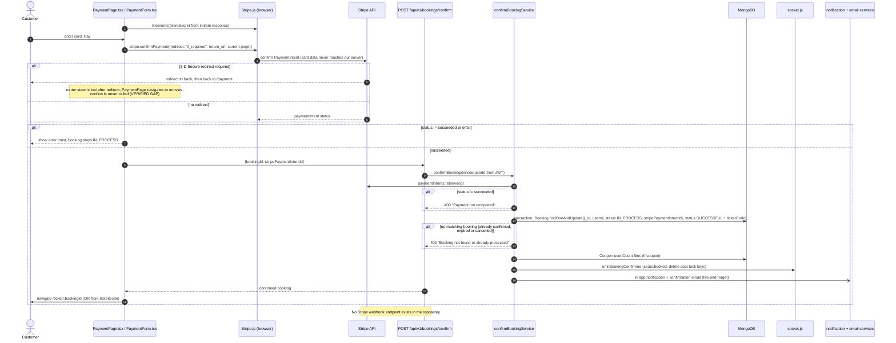
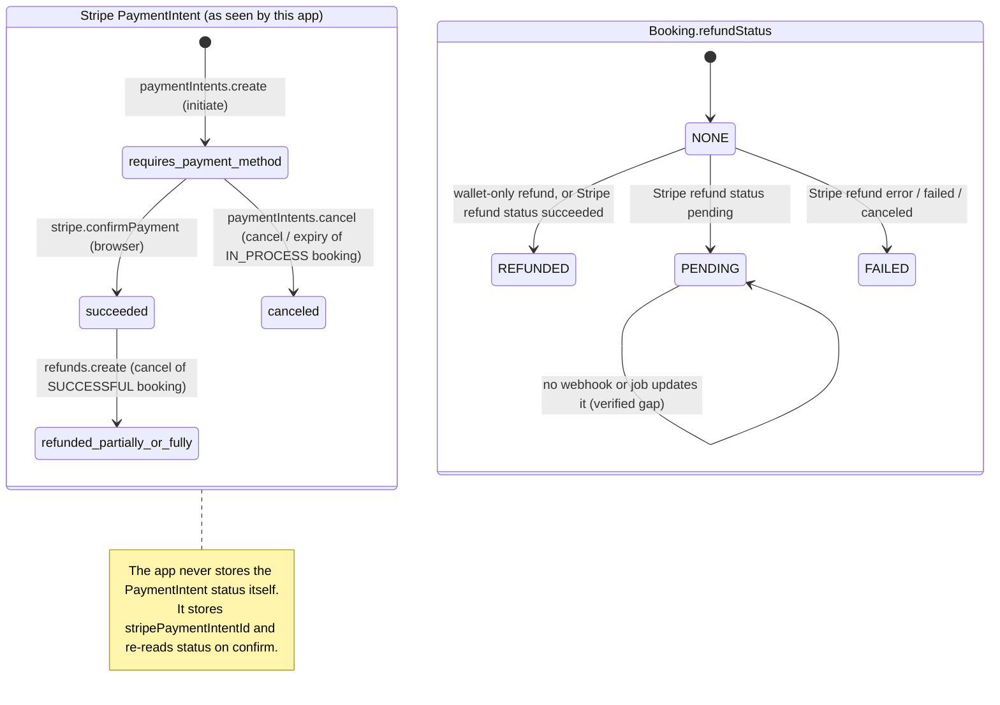

# 09 · Payment and failure handling

[← Back to index](README.md)

## 1. Payment integration as implemented

| Aspect | Implementation | Evidence |
|---|---|---|
| Provider | Stripe, **PaymentIntents** API, currency `inr`, amounts in paise | `booking.service.js`, `prime.service.js`, `wallet.service.js` |
| Card capture | Browser via Stripe Elements + `stripe.confirmPayment({redirect: "if_required"})` | `PaymentForm.tsx` |
| Card data handling | Never reaches the server | — |
| Confirmation | **Client-driven**: the browser calls `POST /bookings/confirm` (or `/prime/confirm`, `/gift-cards/confirm`); the server re-reads the PaymentIntent from Stripe and requires `status === "succeeded"` | `confirmBookingService`, `confirmPrimeService`, `confirmGiftCardService` |
| Webhooks | **Not found in repository** (no route, no signature verification, no `express.raw`) | `grep -ri webhook server/` → none |
| Refunds | `stripe.refunds.create({payment_intent, amount}, {idempotencyKey: "refund-<bookingId>"})` after the cancel transaction | `cancelBookingService` |
| Unpaid intent cleanup | `stripe.paymentIntents.cancel` when an `IN_PROCESS` booking is cancelled or expired | `cancelBookingService` |
| Wallet | Internal ledger; can pay all or part of a booking | `wallet.service.js` |
| Mode | Test keys in this deployment (publishable key prefix `pk_test_`) | Vercel/Render configuration |

Three products use Stripe the same way:

| Product | Create | Confirm | Idempotency of confirm |
|---|---|---|---|
| Ticket booking | `POST /bookings/initiate` | `POST /bookings/confirm` | Conditional update `status: IN_PROCESS` + matching `stripePaymentIntentId` |
| Prime Pass | `POST /prime/subscribe` | `POST /prime/confirm` | `primePaymentIds` array guard; metadata must match the user |
| Gift card | `POST /gift-cards/purchase` | `POST /gift-cards/confirm` | Conditional update `status: PENDING`; metadata must match the user |

## 2. Payment sequence

*Source: [diagrams/payment-sequence.mmd](diagrams/payment-sequence.mmd)*

## 3. Payment-related state

*Source: [diagrams/payment-state-machine.mmd](diagrams/payment-state-machine.mmd)*

## 4. Failure analysis

Each row says whether the **current code handles** the failure, and what is proposed (clearly labelled) where it doesn't.

### F1. Card declined or authentication failed

- **Handled.** `confirmPayment` returns an error, so the UI shows it. The booking stays `IN_PROCESS` with seats reserved, and the user can retry on the same intent while still on the page.
- After 10–15 min the expiry job cancels the booking, cancels the PaymentIntent and releases the seats.

### F2. Payment succeeds, but the booking expires

- **Evidence:** `expireStaleBookingsService` cancels any `IN_PROCESS` booking older than 10 minutes via `cancelBookingService`. That sets `CANCELLED` and `refundAmount: 0`, then calls `paymentIntents.cancel()`. For an intent that already **succeeded**, Stripe rejects the cancel. The error is caught and logged as `"Stripe cancel skipped"`, and nothing else happens.
- **Scenario:** a user pays at minute 11 (slow 3-D Secure, bank page, or a confirm call that never arrives, see F3). The job cancels the booking and frees the seats. Stripe has captured the money. `POST /bookings/confirm` then fails with "Booking not found or already processed".
- **Result:** the customer is charged, has no ticket, gets no refund, and the seat may be resold.
- **Status:** Verified limitation (code path). **Severity:** High.
- **Proposed fix:** a Stripe webhook (`payment_intent.succeeded`) that confirms the booking if it's still reservable, or refunds automatically if it isn't. Alternatively, before the expiry job cancels a booking, retrieve the intent: if it succeeded, confirm instead of cancelling.

### F3. Browser never calls `/bookings/confirm`

- **Causes:** tab closed or network lost after Stripe succeeded; **3-D Secure redirect**. `return_url` is the current `/payment` page, and after the redirect `location.state` is gone, so `PaymentPage` navigates to `/movies` and never calls confirm.
- **Result:** leads straight into F2.
- **Status:** Verified limitation. Indian cards commonly require 3-D Secure, so in live mode this path is normal, not rare. The test card `4242…` does not redirect, which hides it in testing.
- **Proposed fix:** the webhook (above), plus a `return_url` like `/payment/complete?booking=<id>` that reads `payment_intent` from the query string and calls confirm.

### F4. Duplicate confirm calls

- **Handled.** The second call finds no `IN_PROCESS` booking and returns 400. The first result stands. No double side effects, because the side effects run only after a successful update.

### F5. Duplicate callback or webhook

- **Not applicable.** There are no webhooks. If one is added, it must be idempotent (store the processed event id).

### F6. Database failure mid-booking

- **Handled for writes inside the transaction:** seats, wallet debit and the booking record commit together or not at all.
- **Partially handled:** the Stripe PaymentIntent is created inside the transaction callback. If the commit fails afterwards (or the callback is retried), the intent exists without a booking. It's never confirmed, so no money moves, but it lingers in Stripe (`requires_payment_method`).

### F7. Partial updates after commit

| After-commit step | If it fails | Status |
|---|---|---|
| Confirm → coupon `usedCount++` | Count too low; limit can be exceeded | Verified limitation |
| Confirm → socket `seats:booked` | Other browsers keep showing the seat as temp-locked until TTL or refresh; the server state is still correct | Acceptable |
| Confirm/cancel → notification, email | Logged and lost; no retry | Verified limitation |
| Cancel → Stripe refund | `refundStatus: FAILED`, booking cancelled, seats released, **no retry** | Verified limitation |
| Cancel → Stripe refund returns `pending` | `refundStatus: PENDING` forever (nothing updates it) | Verified limitation |

### F8. External service outages

| Service down | Effect |
|---|---|
| Stripe | `initiate` fails with 500 (the transaction aborts, no seats held). Confirm fails; the booking later expires (and see F2 if the payment actually went through). |
| Redis | Server **won't start** (`await connectRedis()`). If Redis drops while running, `GET /movies` returns 500, socket locks fail, and stats fall back to MongoDB. |
| MongoDB | Server won't start; requests fail with 500. |
| Gmail | Emails silently lost (logged). Signup still succeeds, but the user can't get the OTP; "resend" exists. |
| Cloudinary | Upload endpoints return 500. |

### F9. Show deleted or deactivated after tickets are sold

- **Evidence:** `deleteShowService` = `findByIdAndDelete`; `updateShowStatusService` toggles `isActive`. Neither touches bookings, sends notices or starts refunds.
- **Result:** customers hold tickets for a show that's gone. After a **hard delete**, `refundQuote` sees no `showTime` and allows a 100 % refund, but only if the customer cancels themselves. After a **soft deactivate**, the normal time-based policy applies, which can deny a refund for a show that won't run.
- **Status:** Verified limitation. **Proposed fix:** block deleting shows with `SUCCESSFUL` bookings; on deactivation, cancel and fully refund all bookings (including fees) and notify customers.

### F10. Background job failure

- Each stale booking is cancelled in its own try/catch; one failure doesn't stop the loop. There's no alerting, and the jobs pause while the free Render instance sleeps (UptimeRobot pings reduce this).
- Reminder emails are claimed before sending, so a send failure means no reminder rather than duplicates.

### F11. Payment amount integrity

- **Handled.** The amount is computed on the server (`quoteOrder`) and the PaymentIntent is created on the server. Confirm checks the intent id stored on that booking, so a client can't swap in a cheaper intent. Prime and gift card confirms also check `metadata.type` and `metadata.userId`.

## 5. Refund flow summary

| Paid with | Refund destination (`refundTo`) | Mechanism | `refundStatus` |
|---|---|---|---|
| Card | `SOURCE` (default) | Stripe refund of `refundAmount` | `REFUNDED` / `PENDING` / `FAILED` |
| Card | `WALLET` | Wallet credit inside the cancel transaction (instant) | `REFUNDED` |
| Wallet only | either | Wallet credit | `REFUNDED` |
| Mixed | `SOURCE` | Wallet part back to the wallet first, remainder to the card | depends on Stripe |
| Unpaid (`IN_PROCESS`) | — | Wallet hold released (`BOOKING_RELEASED`), PaymentIntent cancelled | `NONE` |

The booking fee and its GST are kept on customer cancellations. Prime members get 100 % inside the 2–24 h window.

## 6. Proposed payment architecture (not implemented)

1. `POST /api/v1/payments/webhook` with `express.raw()` and `stripe.webhooks.constructEvent` (signature secret in env).
2. Handle `payment_intent.succeeded` (confirm the booking, or refund if the booking is no longer `IN_PROCESS`), `payment_intent.payment_failed`, `charge.refunded` / `refund.updated` (reconcile `refundStatus`). Do the same for Prime and gift cards using `metadata.type`.
3. Store processed `event.id` values (unique index) for idempotency.
4. Keep the client-side confirm as a fast path; the webhook becomes the guarantee.
5. Change the expiry job to check the intent status before cancelling.
