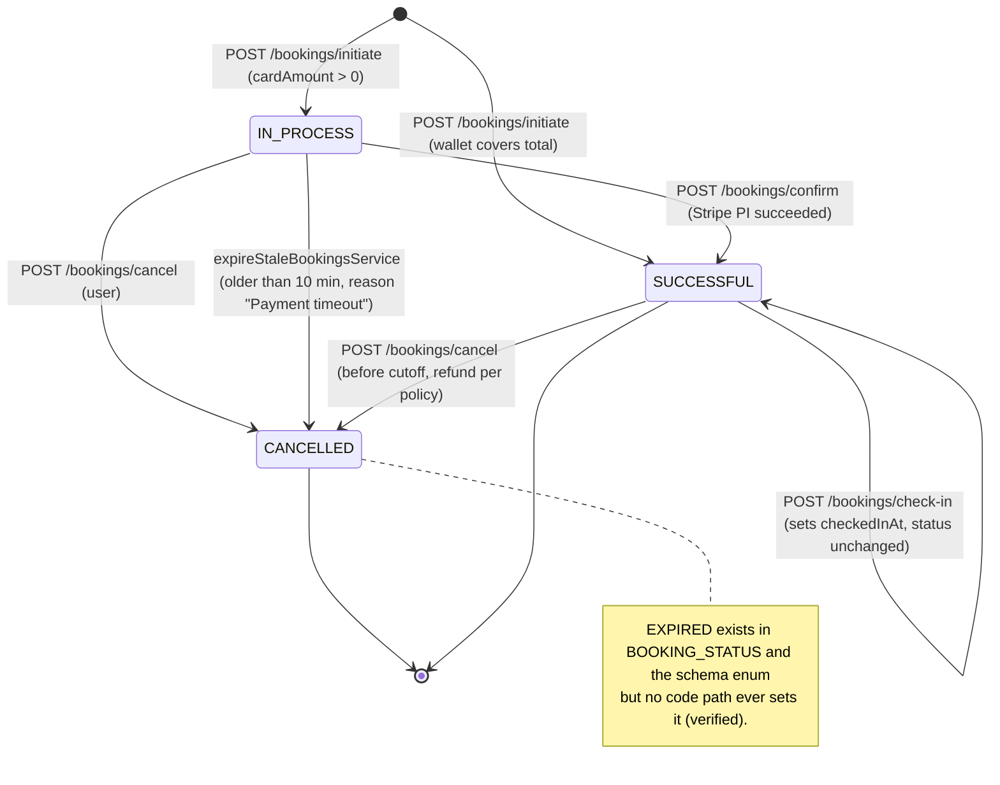
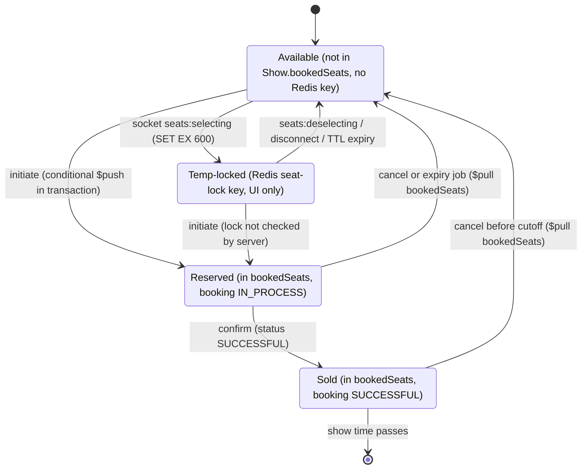
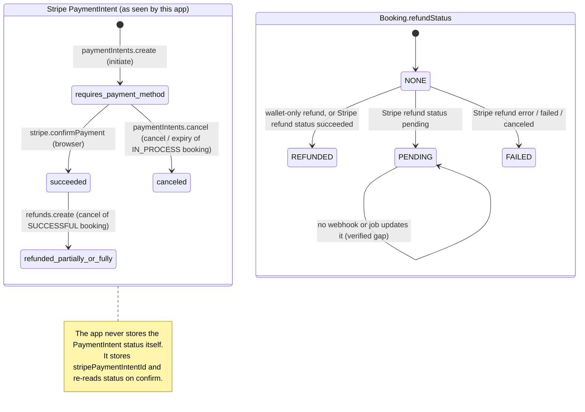
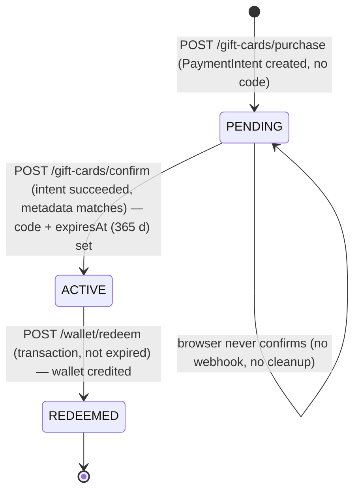
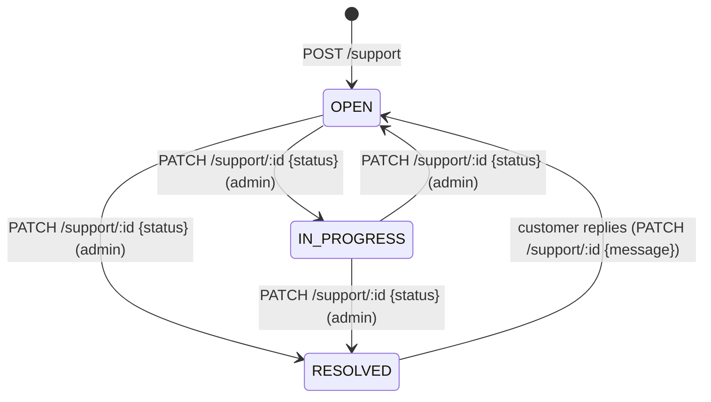
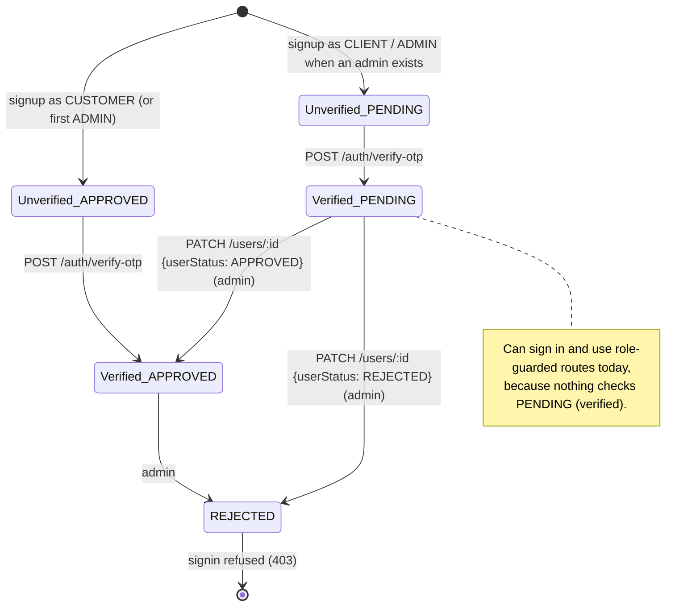
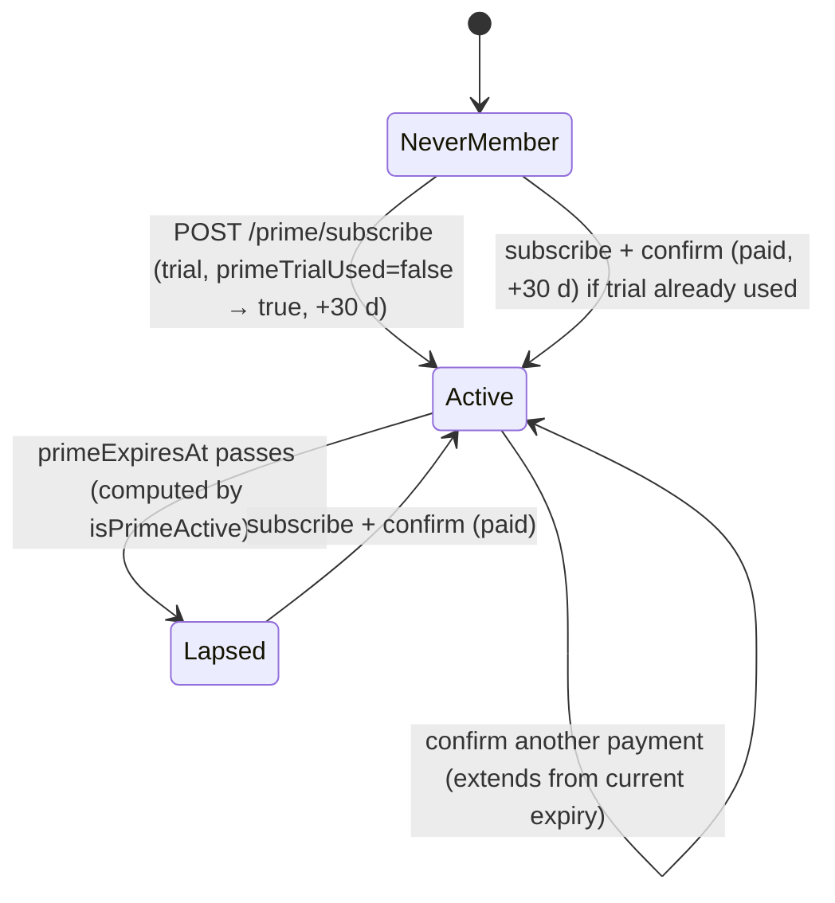

# 10 · State machines

[← Back to index](README.md)

Only statuses that exist in the code are shown. Transition labels name the route or function that performs them.

## Booking (`Booking.status`)

*Source: [diagrams/booking-state-machine.mmd](diagrams/booking-state-machine.mmd)*

| From | To | Trigger | Guard |
|---|---|---|---|
| — | `IN_PROCESS` | `initiateBookingService` with `cardAmount > 0` | Seats free (conditional update) |
| — | `SUCCESSFUL` | `initiateBookingService` with wallet covering the total | Wallet balance ≥ total |
| `IN_PROCESS` | `SUCCESSFUL` | `confirmBookingService` | Stripe intent `succeeded`; filter `{status: IN_PROCESS, userId, stripePaymentIntentId}` |
| `IN_PROCESS` | `CANCELLED` | `cancelBookingService` (user, or expiry job after 10 min) | Filter on current status |
| `SUCCESSFUL` | `CANCELLED` | `cancelBookingService` | `refundQuote.cancellable` (≥ cutoff before show, not checked in) |
| `SUCCESSFUL` | `SUCCESSFUL` (+`checkedInAt`) | `checkInBookingService` | Owner/admin, time window, `checkedInAt: null` |

`EXPIRED` is declared but **never set** (verified). Expired bookings appear as `CANCELLED` with reason "Payment timeout — auto expired".

## Seat (derived, per show)

*Source: [diagrams/seat-state-machine.mmd](diagrams/seat-state-machine.mmd)*

There's no seat document. "Reserved" vs "Sold" is the status of the booking that holds the seat id in `Show.bookedSeats`. **Verified anomaly:** `PATCH /shows/:id` can jump any seat from Reserved/Sold back to Available ([08 §5](08-booking-and-concurrency-analysis.md#5-verified-break-show-edits-wipe-bookedseats)).

## Payment intent and refund

*Source: [diagrams/payment-state-machine.mmd](diagrams/payment-state-machine.mmd)*

Stripe statuses other than those shown (e.g. `requires_action`, `processing`) occur inside Stripe.js and aren't persisted by this app.

## Gift card (`GiftCard.status`)

## Support ticket (`SupportTicket.status`)

## User account (`User.userStatus`, `isEmailVerified`)

`UNVERIFIED` exists in the enum but is unused; verification is tracked by the boolean `isEmailVerified`. An unverified account is deleted and recreated if the same email signs up again.

## Prime membership (derived)

