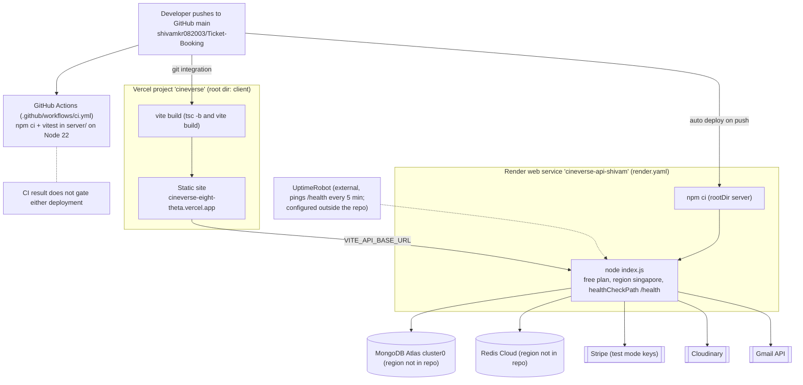
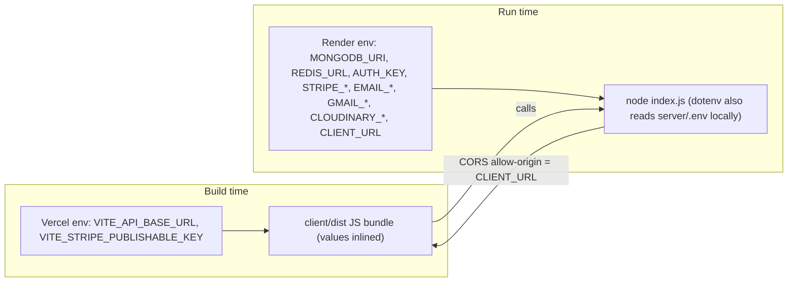

# 13 · Deployment and infrastructure

[← Back to index](README.md)

## Production deployment (current)

*Source: [diagrams/deployment-architecture.mmd](diagrams/deployment-architecture.mmd)*

| Component | Platform | Configuration in repo | Notes |
|---|---|---|---|
| Frontend | **Vercel** project `cineverse`, root directory `client`, framework Vite, Node 22 | `client/vercel.json` (SPA rewrite `/(.*)` → `/`), `.vercelignore` | Git-connected: every push to `main` builds and deploys. Env: `VITE_API_BASE_URL`, `VITE_STRIPE_PUBLISHABLE_KEY` (inlined at build time). URL: `cineverse-eight-theta.vercel.app`. |
| API | **Render** web service `cineverse-api-shivam` | `render.yaml` (Blueprint): `runtime: node`, `rootDir: server`, `plan: free`, `region: singapore`, `buildCommand: npm ci`, `startCommand: node index.js`, `healthCheckPath: /health`, `NODE_VERSION 22`, secrets as `sync: false` | Auto-deploys on push. One instance. Free plan sleeps when idle and blocks outbound SMTP, which is why email moved to the Gmail REST API. |
| Database | **MongoDB Atlas** `cluster0` | Only the connection string (env) | Network access allows `0.0.0.0/0` because Render free has no static egress IP. |
| Redis | **Redis Cloud** | Only `REDIS_URL` (env) | Three connections per API process. |
| Payments | **Stripe** (test mode) | Keys in env | No webhook endpoint configured. |
| Media | **Cloudinary** | Keys in env | |
| Email | **Gmail API** (OAuth2 refresh token, `gmail.send` scope) | `GMAIL_CLIENT_ID/SECRET/REFRESH_TOKEN` | Sender is a personal Gmail address. |
| Keep-alive | **UptimeRobot** (outside the repo) | — | 5-minute HTTP check on `/health`. |

**Not found in repository:** infrastructure-as-code beyond `render.yaml` (no Terraform), CDN or WAF configuration for the API, staging environment, database backups/restore runbook, secrets manager integration, custom domains.

## CI/CD

| Stage | What runs | Gate? |
|---|---|---|
| GitHub Actions `CI` (`.github/workflows/ci.yml`) on push/PR to `main` | `server/`: `npm ci`, `npm test` (vitest, 63 tests, MongoDB downloaded by `mongodb-memory-server`), Node 22, `STRIPE_SECRET_KEY` placeholder | **No.** Vercel and Render deploy on push regardless of the CI result. |
| Vercel build | `npm install` + `npm run build` (`tsc -b && vite build`) in `client/` | A TypeScript error fails the frontend deploy. |
| Render build | `npm ci` in `server/` | No tests, no lint. |

Not covered by CI: client lint/build, k6, any end-to-end test.

## Local and container options (in repo)

| Option | Files | What it starts |
|---|---|---|
| Plain Node | `server/package.json` (`npm run dev` via nodemon, `npm start`), `client/package.json` (`npm run dev`) | API on `PORT`, Vite on 5173. MongoDB and Redis from env (Atlas / Redis Cloud, or local). |
| Docker Compose | `docker-compose.yml` | `redis:7-alpine` (6379), `server` (built from `server/Dockerfile`, port 3000, `REDIS_URL=redis://redis:6379`, env from `server/.env`), `client` (multi-stage build → nginx on host port 5173). MongoDB stays on Atlas. |
| Server image | `server/Dockerfile` | `node:22-alpine`, `npm ci --omit=dev`, non-root `node` user, `HEALTHCHECK` on `/health`, `CMD node index.js`. |
| Client image | `client/Dockerfile`, `client/nginx.conf` | Build stage bakes `VITE_*` args; nginx serves `dist`, SPA fallback, 1-year immutable cache for `/assets/`. |
| Demo data | `server/scripts/seed.js` (`npm run seed`, `--reset`) | Writes to whatever `MONGODB_URI` points at. Seeded shows cover roughly −14 to +6 days from the run date. |

**Inconsistency:** `server/vercel.json` configures the API as a Vercel serverless function. The README itself explains why the API can't run there (long-lived Socket.io connections and timers). The file is unused by the current deployment.

## Configuration flow

Operational lessons recorded during deployment (16–17 Oct 2026):
- The frontend's Stripe publishable key must come from the **same Stripe account** as the server's secret key. A mismatch made the payment element fail to load until both were aligned.
- `CLIENT_URL` must exactly match the Vercel origin (no trailing slash) for both CORS and Socket.io.
- On macOS, port 5000 is taken by AirPlay Receiver; run the API on another port locally.

## Availability characteristics

| Property | Current | Proposed |
|---|---|---|
| Instances | 1 | ≥2 behind a load balancer (sticky sessions for Socket.io polling, or WebSocket-only) |
| Cold start | ~50 s after idle (free tier), mitigated by pings | Paid instance, no sleep |
| Deploy strategy | Render default deploy behaviour (not configured in repo) | Same, plus a readiness check that pings DB and Redis |
| Region | API in Singapore; DB/Redis regions not recorded | Co-locate API, DB and Redis in one region |
| Backups | Whatever the Atlas tier provides (not configured in repo) | Documented backup and restore test |
