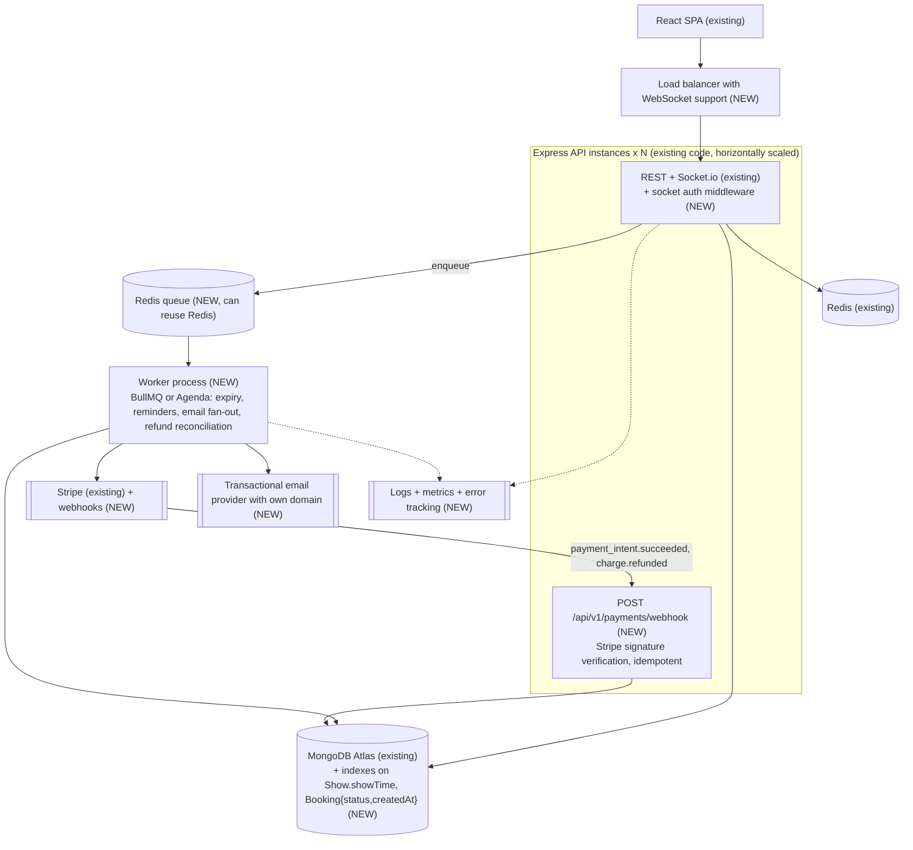

# 14 · Design gaps and recommendations

[← Back to index](README.md)

This page consolidates every issue found in [06](06-database-design.md), [08](08-booking-and-concurrency-analysis.md), [09](09-payment-and-failure-handling.md), [11](11-security-review.md) and [12](12-reliability-and-scalability.md), ordered by priority. **Everything in the "Fix" column is a proposal; none of it is implemented.**

## Prioritised backlog

| P | ID | Issue | Evidence | Failure scenario | Fix | Code / schema / infra | Effort |
|---|---|---|---|---|---|---|---|
| **P0** | C1 | Signup mass assignment → self-declared ADMIN, free wallet, free Prime | `auth.controller.js` `signup`, `user.service.js` `createUser` (reproduced) | An attacker becomes admin on the live site | Allow-list signup fields; no `ADMIN` via signup; audit existing users | Code (+ data audit) | S |
| **P0** | C2 | `PATCH /shows/:id` wipes `bookedSeats`, reactivates shows | `show.validation.js` defaults + `updateShowService` (reproduced) | Sold seats resold → double booking | `.omit({bookedSeats, isActive})`; no defaults on update schemas; regression test | Code | S |
| **P0** | H1 | `PENDING` status not enforced | `auth.middleware.js` | Unapproved owners manage theatres | Require `APPROVED` in role guards | Code | S |
| **P1** | H3 / F2–F3 | No Stripe webhook; 3-D Secure redirect drops confirmation; expiry job cancels paid bookings | `booking.service.js`, `PaymentForm.tsx`, `PaymentPage.tsx` | Customer charged, no ticket, no refund | Webhook + `return_url` completion page + check intent before expiring | Code + Stripe config | M |
| **P1** | H4 | Anonymous image upload; any user can delete any asset | `upload.routes.js` | Storage abuse, posters deleted | Require auth; restrict delete to staff and owned assets | Code | S |
| **P1** | H2 | Unauthenticated sockets; client-chosen `userId` | `socket.js` | Seat map DoS, lock theft | `io.use` JWT check; ids from token | Code | S |
| **P1** | R1 | `GET /shows` unbounded and fully populated | `show.service.js` (measured 0.6–1.7 MB, 12–31 s) | Slow home page, dashboards time out | Projection, pagination, city/date filters, indexes | Code + index | M |
| **P1** | F9 | Deleting or deactivating shows ignores existing bookings | `show.service.js` | Customers hold tickets for cancelled shows | Block delete if sold; auto-refund + notify on deactivate | Code | M |
| **P2** | M2 | Expired JWT → 500 | `auth.middleware.js` | Users stuck with errors after 24 h | Map all JWT errors to 401 | Code | XS |
| **P2** | M3 | Unlimited concurrent unpaid holds | `initiateBookingService` | Seat hoarding | Per-user hold limits | Code | S |
| **P2** | M4 | Rate limiter may see the proxy IP | `index.js` (no `trust proxy`) | Site-wide 429s, or no effective limit | `app.set("trust proxy", 1)` + verify | Code | XS |
| **P2** | M1 | Shared response singletons | `response.utils.js` | Wrong message/err on concurrent responses | Fresh objects per response | Code (mechanical) | M |
| **P2** | R6 | Refunds `PENDING`/`FAILED` never reconciled | `cancelBookingService` | Customer never refunded | Webhook `refund.updated` + retry job | Code | S |
| **P2** | R3 | Redis is a hard dependency | `index.js`, `movie.service.js` | Redis outage = site outage | Graceful degradation | Code | S |
| **P2** | R5 / L3 | Fire-and-forget email; mass "new movie" mail | `email.service.js`, `movie.service.js` | Lost OTPs; Gmail quota exhausted | Queue + transactional provider; in-app only for announcements | Code + infra | M |
| **P2** | D5 | Coupon `usageLimit` can be exceeded | `pricing.service.js`, `afterConfirmed` | Over-redeemed promotions | Reserve usage atomically at initiate (conditional `$inc` with `usedCount < usageLimit`), release on cancel/expiry | Code | S |
| **P2** | R12 | No logging/metrics/tracing | — | Blind to incidents | pino + request id, Sentry, uptime alerts | Code + infra | M |
| **P3** | D2 | `EXPIRED` status never used | `constants.js`, expiry job | Reports mix user cancels and timeouts | Set `EXPIRED` in the expiry path | Code | XS |
| **P3** | D3 | Hard deletes leave dangling references | movie/theatre/show/user delete services | Broken booking history, odd refunds | Soft delete or guarded delete | Code | M |
| **P3** | D7 | `User.name` unique | `user.model.js` | Legitimate signups fail | Drop the unique index (migration) | Schema | XS |
| **P3** | D9 / L1 | Theatre/movie update schemas inject defaults; theatre `owner` editable | `theatre.validation.js`, `movie.validation.js` | Data reset by partial API updates; theatre handed away | No defaults on update schemas; strip `owner` | Code | S |
| **P3** | — | Single-show creation has no overlap check | `createShowService` | Two shows on one screen at once | Reuse bulk overlap logic | Code | S |
| **P3** | M5 | JWT in `localStorage`, no revocation | `AuthContext.tsx`, `api/index.api.ts` | XSS steals session | httpOnly cookies + token versioning | Code | M |
| **P3** | — | CI doesn't gate deploys; client not built/linted in CI | `.github/workflows/ci.yml` | Broken code ships | Require CI before deploy; add client job | Infra | S |
| **P3** | — | `server/vercel.json` contradicts the deployment model | file | Confusion | Remove | Repo hygiene | XS |
| **P3** | — | No `.env.example` though README references it | repo root | Onboarding friction | Add example files (names only) | Repo hygiene | XS |

Effort: XS < 1 h, S ≈ ½ day, M ≈ 1–3 days (single developer, rough).

## Proposed target architecture

The diagram below is **not** the current system. Current state: [03](03-current-system-architecture.md).

*Source: [diagrams/proposed-architecture.mmd](diagrams/proposed-architecture.mmd)*

| New element | Solves | Notes |
|---|---|---|
| Stripe webhook endpoint | F2, F3, R6 | Raw body + signature check; idempotent on `event.id` |
| Worker process + Redis-backed queue | R4, R5, L3, R6 | Reuses the existing Redis; jobs become retryable and observable |
| Socket auth middleware | H2 | Same JWT as REST |
| Load balancer + N API instances | Availability | Needs sticky sessions (or WebSocket-only) and `trust proxy` |
| Indexes `{isActive, showTime}`, `{movieId, showTime}`, bookings `{status, createdAt}` | R1, R8 | No migration framework exists; create via Mongoose `index()` + `syncIndexes` |
| Transactional email provider on a custom domain | R5, deliverability | Replaces the personal Gmail sender |
| Logging/metrics/error tracking | R12 | Request ids through REST and jobs |

## Things deliberately **not** recommended yet

| Idea | Why not now |
|---|---|
| Microservices | One small team and one database; the problems above are correctness bugs, not service boundaries. |
| Kafka or another event bus | A Redis queue covers the async needs at this scale. |
| Sharding / per-seat documents | No measured contention; the single conditional update is simple and correct (once C2 is fixed). |
| Read replicas | Reads are mostly cached; fix the `/shows` payload first. |
| Virtual waiting room | Only relevant for hypothetical hot releases ([12](12-reliability-and-scalability.md#capacity-estimation-hypothetical)). |
